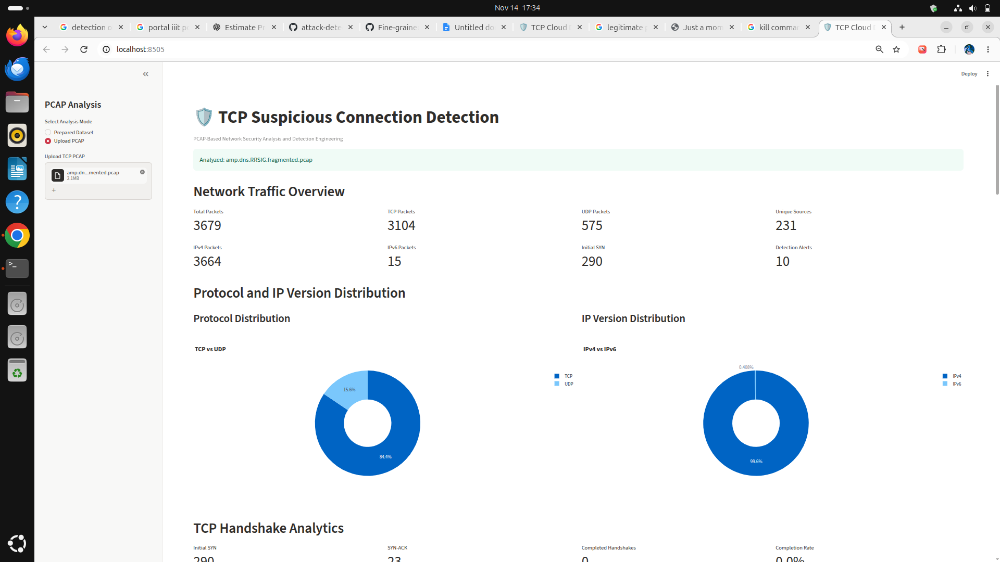
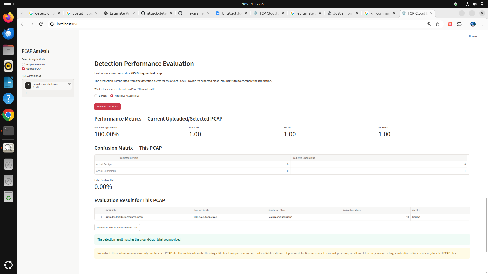

# SOC-Oriented TCP Network Threat Detection & Analysis Framework

**Python \| Scapy \| Streamlit \| Network Security Monitoring \|
Detection Engineering \| PCAP Analysis**

A SOC-focused network traffic analysis and detection framework that
identifies suspicious TCP connection patterns from PCAP files. It
demonstrates how network telemetry can be converted into security
alerts, investigated through a dashboard, and evaluated using labelled
datasets.

This project is designed as a practical portfolio project for **SOC
Analyst, Security Operations, Network Security Analyst, and Detection
Engineer** roles.

------------------------------------------------------------------------

## 1. Project Overview

Security Operations Centre (SOC) analysts investigate network activity
to identify suspicious communication, reconnaissance, and potential
attack behaviour.

This project implements a Python-based detection framework that analyses
TCP traffic and identifies potentially suspicious patterns, including:

-   TCP SYN burst activity
-   Incomplete TCP three-way handshakes
-   TCP port scanning behaviour
-   Repeated SYN / retransmission candidates
-   Suspicious connection patterns within configured time windows

The framework provides a Streamlit dashboard where analysts can upload
PCAP files, inspect traffic, review detection alerts, and evaluate
detection results.

## 2. Dashboard Screenshots

### Network Traffic Overview



### Detection Results and Security Alerts


### Detection Evaluation



> **Screenshot note:** Keep the three PNG files inside the
> `screenshots/` folder in the repository. The relative image paths
> above allow GitHub to render them directly in this README.

## 3. SOC Use Cases

  -----------------------------------------------------------------------
  Use case                Detection objective     SOC relevance
  ----------------------- ----------------------- -----------------------
  SYN Burst Detection     Identify unusually high Possible SYN flood or
                          SYN activity            connection-flood
                                                  investigation

  TCP Port Scan Detection Identify hosts          Network reconnaissance
                          connecting to multiple  investigation
                          destination ports       

  Incomplete Handshake    Identify TCP handshakes Investigate failed or
  Analysis                that do not complete    suspicious connection
                                                  attempts

  Repeated SYN Detection  Identify repeated SYN   Investigate
                          patterns                retransmission
                                                  candidates and
                                                  connection instability

  PCAP Investigation      Analyse uploaded        Support network-based
                          network captures        incident triage

  Detection Evaluation    Compare alerts against  Measure detection
                          labelled scenarios      effectiveness
  -----------------------------------------------------------------------

**Note:** These are detection and investigation use cases, not proof of
malicious activity. Analysts should validate alerts against surrounding
network and endpoint context.

## 4. SOC Investigation Workflow

The project follows a simplified SOC detection and investigation
workflow:

``` text
          Network Traffic / PCAP
                    |
                    v
             Packet Collection
                    |
                    v
             Scapy Packet Parser
                    |
                    v
           TCP Feature Extraction
                    |
                    v
              Detection Engine
                    |
          +---------+----------+
          |         |          |
          v         v          v
       SYN Burst  Port Scan  Handshake
          |         |          |
          +---------+----------+
                    |
                    v
             Security Alerts
                    |
                    v
            Streamlit Dashboard
                    |
                    v
          Analyst Investigation
                    |
                    v
           Detection Evaluation
```

## 5. Detection Engineering

The detection engine analyses TCP packet characteristics and applies
configurable thresholds.

  Detection rule        Configured threshold
  ------------------- ----------------------
  SYN Burst                              100
  Port Scan                               20
  Repeated SYN                             3
  Analysis Window                 10 seconds
  Handshake Timeout               30 seconds

These are initial experimental thresholds. They should be tuned and
validated against diverse network traffic before operational SOC
deployment.

### Detection engineering capabilities

-   Packet parsing and feature extraction
-   Source and destination IP analysis
-   TCP flag inspection
-   Connection and handshake analysis
-   Time-window-based detection
-   Alert generation
-   Detection testing and evaluation

## 6. Technologies Used

  Technology       Purpose
  ---------------- -------------------------------------------
  Python 3.12      Detection engine and application logic
  Scapy            Network packet and PCAP analysis
  Pandas           Data processing and evaluation
  Streamlit        SOC investigation dashboard
  Plotly           Traffic and alert visualisation
  Scikit-learn     Evaluation metrics
  Pytest           Automated testing
  Git and GitHub   Version control and project documentation

## 7. Project Structure

``` text
tcp-cloud-detection/
|
|-- app.py
|-- evaluation.py
|-- evaluation_dataset.py
|-- generate_pcaps.py
|-- validate.py
|-- requirements.txt
|-- pytest.ini
|-- README.md
|
|-- detection/
|   |-- tcp_analyzer.py
|   |-- evaluator.py
|
|-- datasets/
|   |-- legitimate.pcap
|   |-- syn_burst.pcap
|   |-- port_scan.pcap
|   |-- retransmission.pcap
|   |-- labels.csv
|
|-- tests/
|   |-- test_detection.py
|
|-- docs/
|   |-- methodology.md
|
|-- screenshots/
|   |-- 01_network_overview.png
|   |-- 02_detection_results.png
|   |-- 03_evaluation_results.png
|
|-- uploads/
|-- output/
|-- backups/
```

## 8. Installation and Setup

### Prerequisites

-   Ubuntu or another Linux distribution
-   Python 3.12 or compatible version
-   Git
-   pip

### Step 1: Clone the repository

``` bash
git clone https://github.com/ameyankushpatil-ux/tcp-cloud-detection.git
cd tcp-cloud-detection
```

### Step 2: Create a virtual environment

``` bash
python3 -m venv .venv
source .venv/bin/activate
```

### Step 3: Install dependencies

``` bash
pip install -r requirements.txt
```

## 9. Generate Synthetic Network Traffic

Generate the prepared test PCAP datasets:

``` bash
python generate_pcaps.py
```

The project includes four labelled scenarios:

  Dataset                 Ground truth Scenario
  --------------------- -------------- ----------------
  legitimate.pcap                    0 Legitimate TCP
  syn_burst.pcap                     1 SYN Burst
  port_scan.pcap                     1 Port Scan
  retransmission.pcap                1 Repeated SYN

## 10. Run the Detection Dashboard

Start the Streamlit application:

``` bash
streamlit run app.py --server.address 0.0.0.0 --server.port 8505
```

Open the dashboard at:

``` text
http://localhost:8505
```

### Analyst workflow

1.  Open the dashboard.
2.  Select the prepared dataset or upload a PCAP/PCAPNG file.
3.  Run the traffic analysis.
4.  Review generated security alerts.
5.  Investigate suspicious TCP connection patterns.
6.  Review the evaluation results.

## 11. Detection Evaluation

The project supports two evaluation workflows.

### Single-PCAP evaluation

``` bash
python evaluation.py
```

This workflow supports evaluating an individual PCAP against an
analyst-provided label.

### Prepared multi-PCAP evaluation

``` bash
python evaluation_dataset.py
```

This workflow evaluates the prepared labelled datasets and generates:

``` text
output/multi_pcap_evaluation.csv
```

### Initial experimental results

The initial experiment uses four controlled synthetic PCAP datasets.

  Metric                  Result
  --------------------- --------
  Accuracy                  100%
  Precision                 1.00
  Recall                    1.00
  F1-score                  1.00
  False Positive Rate       0.00

### Confusion matrix

  Actual / Predicted     Benign   Suspicious
  -------------------- -------- ------------
  Benign                      1            0
  Suspicious                  0            3

**Important evaluation limitation:** These results represent performance
on four controlled synthetic scenarios only. They do not demonstrate
generalisation to real-world network traffic or production SOC
environments. Larger, independently labelled datasets are required for
meaningful operational validation.

## 12. Automated Testing

Run the test suite:

``` bash
pytest -v
```

The current test suite contains five tests. Run the command above to
verify the result in your environment.

## 13. SOC Skills Demonstrated

This project demonstrates practical experience with:

-   Network security monitoring
-   PCAP analysis and packet investigation
-   TCP protocol and handshake analysis
-   Security alert generation
-   Network reconnaissance detection
-   Detection rule development
-   Detection threshold tuning
-   False-positive and false-negative evaluation
-   Python-based security automation
-   Security dashboard development
-   Automated testing and documentation

## 14. Limitations

-   The evaluation dataset is small and synthetic.
-   Detection thresholds require validation against diverse traffic.
-   Repeated SYN packets are treated as retransmission candidates.
-   An alert does not independently establish malicious intent.
-   The prototype does not establish cloud-provider attribution.
-   Production SOC deployment requires additional validation,
    enrichment, and integration.

## 15. Future Enhancements

-   MITRE ATT&CK technique mapping for applicable detections.
-   Integration with SIEM platforms such as IBM QRadar and Splunk.
-   Alert enrichment using threat intelligence.
-   Improved TCP retransmission and handshake correlation.
-   Detection latency measurement.
-   Larger real-world labelled PCAP datasets.
-   JSON-based alert export for SIEM ingestion.
-   Integration with incident response and case-management workflows.

## 16. Author

**Amey Patil**

Cybersecurity \| SOC Operations \| Network Security Monitoring \|
Detection Engineering

-   GitHub: [ameyankushpatil-ux](https://github.com/ameyankushpatil-ux)
-   Project Repository:
    [tcp-cloud-detection](https://github.com/ameyankushpatil-ux/tcp-cloud-detection)

------------------------------------------------------------------------

**Disclaimer:** This project is intended for academic research,
learning, and authorised network security analysis. Use only network
traffic that you are authorised to inspect.
